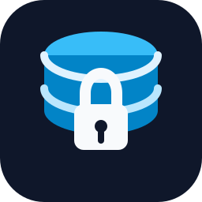
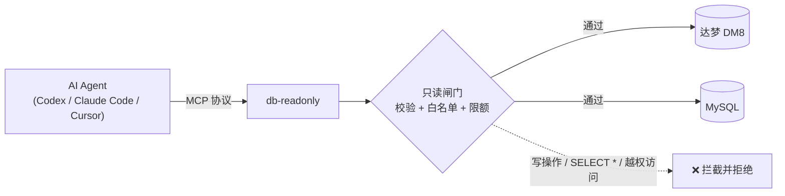

<p align="center">
  
</p>


<h1 align="center">🔒 db-readonly</h1>

<p align="center">
  <b>给 AI 一只「只读之手」</b> —— 安全、可控、开箱即用的数据库只读 MCP 服务
</p>


<p align="center">
  原生支持 <b>达梦 DM8</b> 与 <b>MySQL</b> · 适配 Codex / Claude Code / Cursor 等任意 MCP 客户端
</p>


<p align="center">
  <a href="README.md">简体中文</a> · <a href="README.en.md">English</a>
</p>


<p align="center">
  
  
  
  
  
</p>


---

## 🤔 为什么需要 db-readonly？

AI Agent 越来越强，但**你敢把生产数据库直接交给它吗？**

- 它可能写出 `DELETE FROM users`，哪怕只是一次误操作
- 它可能生成一条慢查询，把线上库拖垮
- 它可能访问到你没打算暴露的业务表

`db-readonly` 在 AI 与数据库之间加一道**只读闸门**：查询能力充分开放，写操作物理拦截，危险行为层层设防。**AI 能读什么、能读多少、能读多久，全部由你说了算。**

## ✨ 核心特性

| 特性                          | 说明                                                         |
| ----------------------------- | ------------------------------------------------------------ |
| 🔒 **强制只读**                | SQL 执行前只读校验，`INSERT / UPDATE / DELETE / CREATE / ALTER / DROP` 一律拒绝 |
| 🗂️ **多数据库**                | 原生支持达梦 DM8 与 MySQL，信创环境也能接入 AI 生态          |
| 📋 **表级白名单 / 黑名单**     | `allowTables` / `denyTables` 精细控制 AI 可访问的表          |
| 🚫 **禁止 `SELECT *`**         | 只允许查询指定表的指定字段，防止一次拉全表                   |
| 📏 **行数 + 超时双限制**       | `maxRows` 限制返回行数，`queryTimeoutSeconds` 卡死慢查询     |
| 🔑 **密码零落盘**              | 凭据只从环境变量读取，配置文件与 Git 历史中永不出现明文密码  |
| 🧩 **Java 实体名推断**（达梦） | Java 风格实体名自动映射表名，后端团队零成本接入              |
| ⚡ **开箱即用**                | PowerShell 一键安装 + YAML 模板配置，5 分钟接入 Codex        |

## 🏗️ 工作原理



## 🛡️ 安全设计：默认安全，纵深防御

| 层级     | 措施                                                      |
| -------- | --------------------------------------------------------- |
| 账号层   | 建议使用仅授予 `SELECT` 权限的数据库只读账号              |
| 数据源层 | 数据源必须显式配置，未配置的 schema / database 一律不可达 |
| 表级     | `allowTables` / `denyTables` 白名单与黑名单               |
| 语句级   | 执行前只读校验，拒绝所有写语句                            |
| 字段级   | 只查询指定表的指定字段，禁止 `SELECT *`                   |
| 资源级   | `maxRows` 行数上限、`queryTimeoutSeconds` 查询超时        |
| 凭据级   | 密码仅存环境变量，不进配置文件、不进 Git                  |

## 🧰 MCP 工具一览

| 工具              | 说明                         |
| ----------------- | ---------------------------- |
| `datasource_list` | 列出已配置的数据源           |
| `table_describe`  | 查看表的字段与类型           |
| `table_query`     | 查询指定表的指定字段         |
| `sql_query`       | 执行受限制的 `SELECT` 查询   |
| `entity_resolve`  | 达梦：Java 实体名 → 表名解析 |
| `entity_describe` | 达梦：按实体名查看表结构     |
| `entity_query`    | 达梦：按实体名查询           |

> MySQL 第一版暂不支持 entity 映射，推荐先用 `table_describe` 确认真实表名和字段名，再用 `table_query` 或 `sql_query` 查询。

## 🚀 快速开始（5 分钟接入 Codex）

### 1. 安装依赖

```powershell
cd path\to\db-readonly
.\setup.ps1
```

> **ODBC 驱动需自行安装**（`setup.ps1` 只安装 Python 依赖）：
>
> - 达梦：`DM8 ODBC DRIVER`
> - MySQL：[MySQL Connector/ODBC](https://dev.mysql.com/downloads/connector/odbc/)
>
> 驱动安装后执行 `.\setup.ps1 -Drivers` 查看本机真实驱动名，再填入配置。

### 2. 配置数据源

```powershell
Copy-Item config.example.yaml config.local.yaml
```

达梦示例：

```yaml
datasources:
  dm-dev:
    dbType: "dm"
    project: "your-project"
    env: "dev"
    description: "Development Dameng database"
    driver: "DM8 ODBC DRIVER"
    host: "127.0.0.1"
    port: 5236
    schema: "YOUR_SCHEMA"
    username: "READONLY_USER"
    passwordEnv: "DM_READONLY_PASSWORD"
    maxRows: 100
    queryTimeoutSeconds: 10
    allowTables: ["*"]
    denyTables: []
```

MySQL 示例：

```yaml
datasources:
  mysql-dev:
    dbType: "mysql"
    project: "your-project"
    env: "dev"
    description: "Development MySQL database"
    driver: "MySQL ODBC 8.0 Unicode Driver"
    host: "127.0.0.1"
    port: 3306
    schema: "your_database"
    username: "readonly_user"
    passwordEnv: "MYSQL_READONLY_PASSWORD"
    maxRows: 100
    queryTimeoutSeconds: 10
    allowTables: ["*"]
    denyTables: []
```

配置说明：

- `dbType` 不填时默认 `dm`
- 达梦的 `schema` 表示 schema；MySQL 的 `schema` 表示 database
- MySQL 表名和字段名允许小写

### 3. 配置密码（不落盘）

```powershell
[Environment]::SetEnvironmentVariable("MYSQL_READONLY_PASSWORD", "your_password", "User")
```

设置后重启终端或 MCP 客户端。

### 4. 启动

```powershell
.\run.ps1
```

### 5. 验证

```powershell
.\.venv\Scripts\python.exe scripts\verify.py
.\.venv\Scripts\python.exe scripts\check_db_connection.py
```

### 6. 接入 Codex

在 Codex 配置中加入：

```toml
[mcp_servers.db-readonly]
command = "powershell.exe"
args = ["-ExecutionPolicy", "Bypass", "-File", "C:\\path\\to\\db-readonly\\run.ps1"]
```

修改后重启 Codex 即可使用。

## 🆚 为什么不用通用 db-mcp？

| 对比点    | 通用 db-mcp           | db-readonly                                     |
| --------- | --------------------- | ----------------------------------------------- |
| 达梦 DM8  | 几乎空白              | ✅ 原生支持                                      |
| 只读策略  | 多为"放行所有 SELECT" | ✅ 表级白/黑名单 + 禁 `SELECT *` + 行数/超时限额 |
| 密码管理  | 常写入配置            | ✅ 仅环境变量，零落盘                            |
| Java 团队 | —                     | ✅ 实体名 → 表名自动推断                         |

## 📌 Roadmap

- [ ] PostgreSQL / Oracle / SQL Server 支持
- [ ] 行级、字段级细粒度权限
- [ ] 查询审计日志
- [ ] Linux / macOS 支持

> 以上为建议方向，欢迎提 Issue / PR 一起完善。

<!-- ## 📄 License

按你的实际许可证填写，例如 MIT / Apache-2.0 -->

---

<p align="center">
  <b>你的数据库，只有 AI 的「读」。</b><br/>
  ⭐ 如果这个项目对你有帮助，欢迎 Star 支持
</p>

